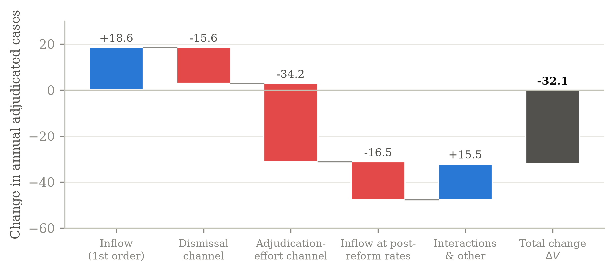

# Discrete Rules, Continuous Behavior: How Judges Responded to China's 2015 Case-Registration Reform

Zichen Fang (Peking University; visiting student, University of Chicago). Work in progress, October 2026.

**Research note:** [`note/research_note.pdf`](note/research_note.pdf)

In May 2015, China's courts stopped screening administrative suits and began registering every suit that met formal requirements. Filings jumped, withdrawals fell, and procedural dismissals more than doubled. This repository contains a dynamic model of judges' multi-task incentives that explains this shift, the code that solves and calibrates it, and the reform counterfactual.

- **Model.** A judge allocates effort across mediation, adjudication, and procedural dismissal under clearance and reversal-based performance metrics, with a backlog linking subperiods within a year and years to each other. Reversal risk attaches only to adjudicated cases.
- **Solution.** Nested dynamic programming: a within-year Bellman problem inside an inter-year value iteration. The empirical contraction ratio matches the theoretical modulus β⁴.
- **Counterfactual.** The reform cuts the adjudication share of resolved cases from 66% to 28%. An exact decomposition shows that the behavioral displacement (−50.7) outweighs the mechanical inflow effect (+18.6) on annual adjudicated volume.
- **Next.** Testing the model's predictions on case-level data built from the full archive of published Chinese court judgments.



## Repository structure

```
note/            research note (PDF and LaTeX source)
code/solver/     model primitives, inner effort solver, within-year DP, inter-year value iteration
code/run_regime.py         solve one regime (N, eta) to its stationary value function
code/reform_experiment.py  steady states, volumes, exact decomposition
code/make_figures.py       figures in the note
code/calibration.json      calibrated parameters
results/         solver output (.npz, .json) and logs
figures/         figures (PDF and PNG)
run_all.sh       reproduce everything
```

## Reproducing

Requires Python 3.10+ with `numpy`, `scipy`, and `matplotlib`.

```bash
./run_all.sh
```

This solves the six regimes (pre-reform, post-reform, and sensitivity cases), runs the decomposition, and redraws the figures. It takes about 25 minutes on a 32-core machine; each regime runs its value iteration in parallel over the backlog grid.

## Data

The empirical stage uses the *China Law Yearbook* administrative-litigation tables (2002–2022) and the China Judgments Online archive (1985–2021). These data are not included here.
